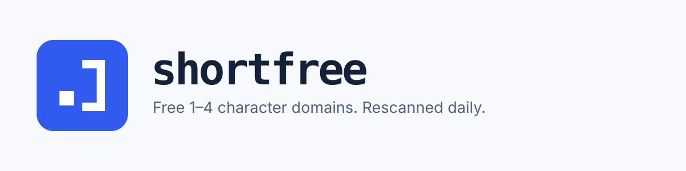

<!-- mcp-name: io.github.maximilianfeix/shortfree -->
<p align="right"><b>English</b> · <a href="README.de.md">Deutsch</a> · <a href="README.zh-CN.md">简体中文</a></p>

<p align="center">
  <a href="https://maximilianfeix.github.io/shortfree/">
    <picture>
      <source media="(prefers-color-scheme: dark)" srcset="brand/banner-dark.svg">
      
    </picture>
  </a>
</p>

<p align="center">
  Every unregistered 1–4 character domain on <b>.com .net .org .io .ai .dev</b> and <a href="docs/tlds.md">more TLDs</a>,<br>
  checked at the registries' own name servers and RDAP services every day.
</p>

<p align="center">
  <a href="https://maximilianfeix.github.io/shortfree/"></a>
  <a href="#lists"></a>
  <a href="#try-it"></a>
  <a href="#mcp"></a>
  <a href="#api"></a>
</p>

<p align="center">
  <a href="https://github.com/maximilianfeix/shortfree/actions/workflows/scan.yml"></a>
  <a href="https://github.com/maximilianfeix/shortfree/actions/workflows/ci.yml"></a>
  <a href="https://github.com/maximilianfeix/shortfree/releases"></a>
  <a href="https://pkg.go.dev/github.com/maximilianfeix/shortfree"></a>
  <a href="LICENSE"></a>
  <a href="https://maximilianfeix.github.io/shortfree/api/v1/badge.json"></a>
</p>

<!-- demo -->

<p align="center">
  <a href="#try-it">Try it</a> ·
  <a href="#numbers">Numbers</a> ·
  <a href="#lists">Lists</a> ·
  <a href="#limits">Limits</a> ·
  <a href="#how-it-works">How it works</a> ·
  <a href="#mcp">MCP</a> ·
  <a href="#api">API</a> ·
  <a href="#cli">CLI</a> ·
  <a href="#faq">FAQ</a> ·
  <a href="#contributing">Contributing</a>
</p>

<a id="try-it"></a>
## Try it

**No install:** open [maximilianfeix.github.io/shortfree](https://maximilianfeix.github.io/shortfree/), type 1–4 characters and see the status on every scanned TLD. Filter the full list by TLD, length and characters.

**Command line** (Go 1.27+):

```sh
go install github.com/maximilianfeix/shortfree/cmd/shortfree@latest
shortfree check x7.dev acme.io
```

**Docker:**

```sh
docker run -i --rm ghcr.io/maximilianfeix/shortfree check x7.dev
```

**Claude Code** (MCP):

```sh
claude mcp add shortfree -- docker run -i --rm ghcr.io/maximilianfeix/shortfree
```

Binaries for Linux, macOS and Windows are attached to each [release](https://github.com/maximilianfeix/shortfree/releases).

<a id="numbers"></a>
## Current numbers

<!-- shortfree:start -->
_The first scan has not run yet._
<!-- shortfree:end -->

<a id="lists"></a>
## Only want the lists?

The companion repo [free-short-domains](https://github.com/maximilianfeix/free-short-domains) holds plain CSV and TXT files and is updated every day after the scan. Raw links:

| File | Content |
|---|---|
| [`csv/all.csv`](https://raw.githubusercontent.com/maximilianfeix/free-short-domains/main/csv/all.csv) | every RDAP-verified free 1–3 character domain on all scanned TLDs |
| `csv/<tld>.csv`, e.g. [`csv/dev.csv`](https://raw.githubusercontent.com/maximilianfeix/free-short-domains/main/csv/dev.csv) | 1–3 character names with status `available`, `dropping` or `unverified` |
| `txt/<tld>.txt`, e.g. [`txt/io.txt`](https://raw.githubusercontent.com/maximilianfeix/free-short-domains/main/txt/io.txt) | verified free 1–3 character domains, one per line |
| `four-letter/<tld>.txt`, e.g. [`four-letter/com.txt`](https://raw.githubusercontent.com/maximilianfeix/free-short-domains/main/four-letter/com.txt) | 4-letter names (a–z) that are not in the zone |

All 4 character names, digits and hyphens included, are in the [`data` release](https://github.com/maximilianfeix/shortfree/releases/tag/data) as `four-<tld>.txt.gz`. The same data is available as a [JSON/CSV API](#api). Everything is CC0: no attribution, no key.

```sh
# every free 2 character .dev domain
curl -s https://raw.githubusercontent.com/maximilianfeix/free-short-domains/main/txt/dev.txt | awk 'length($0) == 6'
```

<a id="limits"></a>
## What it does, and what it can't do

shortfree does:

- check every valid ASCII label (a–z, 0–9, inner hyphens) up to 4 characters: 49,284 names per TLD up to 3 characters and 1,774,224 more at 4 characters;
- ask the TLD's authoritative name servers directly, without a resolver cache;
- confirm each 1–3 character candidate in the registry's RDAP service (`404` = not registered);
- list registered names in redemption or pending delete separately, with their phase and RDAP expiration date (which is not a drop date);
- publish only RDAP answers younger than 14 days as verified, and say per TLD, length and shard what was covered ([coverage.json](docs/api.md#coverage), [accuracy](docs/accuracy.md));
- publish everything as plain files under CC0, with no account, key or tracking.

shortfree can't:

- **see prices or reservations.** "Not registered" (RDAP `404`) is not "registrable": registries reserve some names and sell others at premium prices, and RDAP reports both as unregistered. This is common for 1–2 character names on most TLDs other than .com, .net and .de. Your registrar shows the real price.
- **cover internationalized names.** Only ASCII labels are enumerated and checked; IDNs (Unicode or `xn--` labels) are rejected by `check`.
- **verify 4 character names via RDAP.** They are DNS-only. A registered name without name servers can appear in the 4 character lists. Run `shortfree check` on a name before you rely on it.
- **be newer than the last scan.** The lists are a daily snapshot. A name can be registered minutes after the scan. `shortfree check` and the MCP tool `check_domains` ask the registry live.

<a id="how-it-works"></a>
## How it works

1. **Sweep.** For every label, shortfree sends an `NS` query to the TLD's authoritative name servers. `NXDOMAIN` means the name is not in the zone. All 1–3 character names of one TLD are about 50,000 queries and take minutes.
2. **Verify.** Not being in the zone is not the same as being free: names on hold, without name servers or in redemption are missing too. Each 1–3 character candidate is looked up in the registry's RDAP service (Verisign, PIR, DENIC, Identity Digital, Google Registry, CentralNic and others, see [docs/tlds.md](docs/tlds.md)). Names shorter than a registry's minimum length are skipped. `404` = not registered. `pending delete` or `redemption period` = dropping.
3. **Repeat.** [`scan.yml`](.github/workflows/scan.yml) runs every day at 03:17 UTC, one job per TLD. It sweeps all 1–3 character names and one of seven shards of the 4 character space, so each 4 character name is rechecked once a week. RDAP results are rechecked at least every 10 days. Never-checked names go first, then dropping names, then the oldest checks.

Each RDAP host gets one total rate limit of a few requests per second, shared by all TLDs on that host and all parallel jobs (see [`internal/rdap/rdap.go`](internal/rdap/rdap.go)), to stay within fair use. Scanner state lives in the `data` release, so the git history only carries the small public lists.

<a id="mcp"></a>
## MCP server

`shortfree mcp` is an [MCP](https://modelcontextprotocol.io) server for Claude, Cursor, VS Code and other clients. It has four read-only tools:

| Tool | What it does |
|---|---|
| `check_domains` | live DNS + RDAP check of up to 50 domains, any length, any TLD (RDAP for every scanned TLD) |
| `find_free_domains` | search the daily snapshot by TLD, length, character kind, substring or prefix |
| `suggest_domains` | turn a word or project name into short candidates and return the free ones |
| `domain_stats` | counts per TLD and length |

```sh
claude mcp add shortfree -- docker run -i --rm ghcr.io/maximilianfeix/shortfree
```

Setup for Claude Desktop, Cursor and VS Code, and the scoring rules of `suggest_domains`: [docs/mcp.md](docs/mcp.md).

<a id="api"></a>
## API

A static, read-only JSON/CSV API on GitHub Pages, rebuilt after every scan. No key, CORS enabled.

```
https://maximilianfeix.github.io/shortfree/api/v1/
```

| Path | Content |
|---|---|
| `stats.json` | counts per TLD and length |
| `{tld}.json`, `{tld}/{n}.json` | 1–3 character names on one TLD, optionally of one length |
| `dropping.json` | names in redemption or pending delete, soonest first |
| `changes.json` | names freed or taken in the last 30 days |
| `free.csv` | every RDAP-verified free 1–3 character domain |
| `badge.json` | [shields.io endpoint](https://shields.io/badges/endpoint-badge) with the current count |

```sh
curl -s https://maximilianfeix.github.io/shortfree/api/v1/io/3.json | jq -r '.available[] + ".io"'
```

All endpoints, field meanings and examples in Python and JavaScript: [docs/api.md](docs/api.md). OpenAPI spec: [docs/openapi.yaml](docs/openapi.yaml).

<a id="cli"></a>
## CLI

```sh
shortfree check q7.tools x4k.app abc.de
```

```
DOMAIN    DNS    RDAP        VERDICT
q7.tools  free   available   not registered (RDAP 404)
x4k.app   taken  registered  taken
abc.de    taken  registered  taken
```

`check` works for ASCII domains of any length and TLD. For TLDs without RDAP support in shortfree it gives a DNS-only verdict (`not in DNS`). `-json` prints one object per domain, with `registration` (`not_registered`, `registered`, `dropping`, `not_delegated`, `unknown`) and `registrable` (`no` or `unconfirmed`: shortfree never asks a registrar) next to the verdict:

```sh
shortfree check -json q7.tools | jq '.[0].verdict'
```

The other commands run the scan itself: `scan` (1–3 characters, DNS + RDAP), `scan4` (one shard of 4 characters), `export` (writes `data/` and the table above), `merge` and `mcp`. `shortfree <command> -h` lists the flags.

### In GitHub Actions

The repo is also a GitHub Action. It checks a list of domains and can fail the job, or open an issue, when one becomes free:

```yaml
- uses: maximilianfeix/shortfree@main
  id: watch
  with:
    domains: acme.dev acme.io
    fail-when: never   # free | taken | never
- run: echo '${{ steps.watch.outputs.free }}'   # ["acme.dev"] or []
```

Inputs, outputs and a daily watch workflow: [docs/action.md](docs/action.md).

<a id="faq"></a>
## FAQ

**A name is listed as free, but my registrar says it is unavailable or premium. Why?**
The registry has reserved it or prices it as premium. RDAP only says whether a name is registered, not what it costs. This happens mostly with 1–2 character names outside .com, .net and .de. The site and the MCP tools mark these as likely premium.

**How fresh is the data?**
The scan starts at 03:17 UTC every day. Every JSON file has an `updated` field with the scan time. 1–3 character names are swept daily, 4 character names once a week.

**Why are 4 character names not RDAP-verified?**
There are 1,774,224 of them per TLD. At the rate limits shortfree uses (a few requests per second per registry, shared between its TLDs), one pass over a single TLD would take weeks. DNS answers the same question for most names in minutes.

**Why only these TLDs?**
Each TLD needs a registry RDAP service that answers reliably at a polite rate, and each one adds about 300,000 DNS queries a day (all 1–3 character names plus a seventh of the 4 character space). The current list with registries and sources is in [docs/tlds.md](docs/tlds.md); to add one, see [CONTRIBUTING.md](CONTRIBUTING.md).

**Does shortfree sell domains or track me?**
No. There are no affiliate links, no accounts and no analytics. The site and the API are static files on GitHub Pages. The code is MIT, the data CC0.

<a id="contributing"></a>
## Contributing

Issues and pull requests are welcome. [CONTRIBUTING.md](CONTRIBUTING.md) explains how to add a TLD. Before you open a PR:

```sh
go test ./...
go vet ./...
gofmt -l .
```

To run a small scan locally:

```sh
go run ./cmd/shortfree scan -tlds tools -rdap-time 1m   # writes state/state.json.gz
go run ./cmd/shortfree export -tlds tools -readme ''      # writes data/
```

Security issues: see [SECURITY.md](SECURITY.md).

## License

Code: [MIT](LICENSE). Data: [CC0 1.0](https://creativecommons.org/publicdomain/zero/1.0/). Registry data comes from public DNS and RDAP services.
